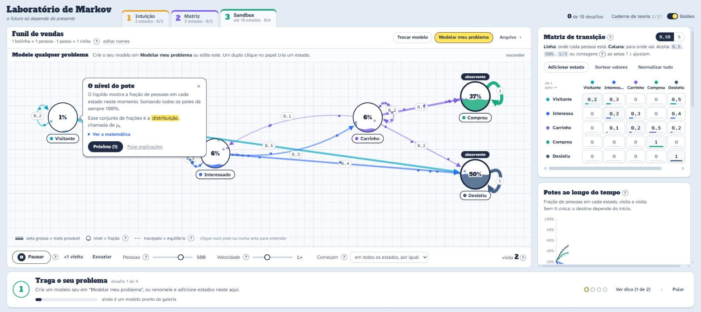

# Laboratório de Markov

Um caderno interativo para **modelar qualquer problema** com cadeias de Markov: clientes, alunos, máquinas, pacientes, jogos. Balões explicam a teoria enquanto você usa, sempre com os nomes do seu modelo.



Funciona direto no navegador. Não tem instalação, conta nem servidor: nada do que você digita ou cola sai do seu computador, e a página só fala com outro site se você clicar para assistir a uma aula no YouTube.

## O que dá para fazer

**Assistir antes de praticar.** O botão **Aulas** reúne uma trilha de videoaulas gratuitas em português, em 7 etapas, com o que praticar no app depois de cada uma. O Caderno de teoria também aponta o trecho de aula que explica cada conceito, quando há um.

**Modelar o seu problema**, de três jeitos:

| Caminho | Quando usar | O que acontece |
|---|---|---|
| Descrever em palavras | Você tem uma ideia, mas não tem números | Um assistente pergunta o que muda, quais são as situações possíveis e as chances de cada uma |
| Tenho dados | Você tem um histórico | Cole sequências ou abra um CSV, com um estado por coluna ou com colunas como cliente, mês e estado. O app mostra como entendeu o arquivo e deixa corrigir; as chances saem da contagem de transições |
| Colar uma tabela | Você já tem a matriz ou as contagens | Copie da planilha: nomes e normalização são tratados automaticamente |

Ou comece por um dos 23 modelos da galeria: funil de vendas, vida de um assinante, inadimplência, caminho na faculdade, epidemia, PageRank, fila, ruína do jogador e outros. Os números da galeria são ilustrativos.

**Voltar atrás.** Toda mudança no modelo pode ser desfeita com o botão **Desfazer** ou `Ctrl+Z` e refeita com `Ctrl+Y`, inclusive trocar de modelo. O histórico continua lá depois de recarregar a página. Se o assistente for fechado no meio, o que foi preenchido fica guardado até o modelo ser criado.

**Entender enquanto usa.** Os balões aparecem conforme você mexe: ao errar a soma de uma linha, explicam por que ela precisa dar 1; ao criar um estado absorvente, explicam o que ele faz. Clique em qualquer pote ou seta para ver o que ela significa no seu modelo. O **Caderno de teoria** reúne 37 conceitos, e os balões podem ser desligados.

**Ver a matemática acontecer.** Cada estado é um pote cujo nível mostra a fração de bolinhas nele, e uma linha tracejada marca o equilíbrio π. O gráfico compara os sorteios (Monte Carlo) com a conta exata.

**Perguntar ao modelo.** "Onde estará daqui a 6 meses?" e "Quanto tempo até chegar?" têm resposta exata. O diagnóstico mostra se a cadeia é irredutível, periódica ou ergódica, quais estados são absorventes e para onde cada um leva.

**Aprender por etapas.** Três níveis (Intuição, Matriz e Sandbox) e 10 desafios curtos, como criar um buraco negro ou achar o equilíbrio sem olhar.

## Como rodar

O projeto usa módulos JavaScript, que exigem um servidor local (abrir o `index.html` com dois cliques não funciona). Qualquer servidor estático serve; com Python:

```bash
python -m http.server 5173
```

Depois abra http://localhost:5173.

Se o navegador mostrar uma versão antiga depois de você editar um arquivo, force a recarga com `Ctrl+Shift+R`.

## Publicar no GitHub Pages

Não há etapa de build. No repositório, vá em **Settings → Pages**, escolha **Deploy from a branch**, a branch `main` e a pasta `/ (root)`. O site fica em `https://SEU-USUARIO.github.io/NOME-DO-REPOSITORIO/`.

## Formato do arquivo de modelo

**Arquivo → Exportar arquivo** gera um JSON que pode ser reaberto em **Importar arquivo** ou versionado. Só `states` e `matrix` são obrigatórios:

```json
{
  "meta": { "title": "Clientes da academia", "unit": "cliente", "step": "mês" },
  "states": [{ "label": "Ativo" }, { "label": "Cancelou" }],
  "matrix": [
    [0.9, 0.1],
    [0, 1]
  ]
}
```

## Atalhos de teclado

| Tecla | O que faz |
|---|---|
| `Ctrl+Z`, `Ctrl+Y` | Desfaz e refaz a última mudança no modelo |
| `Espaço` | Roda ou pausa a simulação |
| `1`, `2`, `3` | Troca de nível |
| `Tab` | Passa pelos potes do diagrama e pelos demais controles |
| `Enter` | Abre a explicação do pote ou da seta em foco |
| `←` `→` `↑` `↓` | A partir de um pote, percorre as setas que saem dele; `Esc` volta ao pote |
| `Shift` + setas | Move o pote em foco |

## Limites

- Até 10 estados por modelo. Em dados com mais do que isso, os estados mais raros são reunidos em "Outros".
- O modelo assume que as chances não mudam com o tempo (cadeia homogênea) e que o estado atual basta para prever o próximo. O Caderno de teoria mostra como contornar isso.
- Um modelo é uma simplificação: confira se ele acerta o que você já sabe antes de usá-lo para decidir algo.

## Como o código está organizado

| Pasta | Conteúdo |
|---|---|
| `js/math/` | Motor sem dependências de interface: classificação da cadeia, π, absorção, tempos de chegada e estimativa a partir de dados |
| `js/learn/` | Trilha de aulas: vídeos, etapas e o trecho que explica cada conceito |
| `js/models/` | Validação de modelos importados, catálogo da galeria, link compartilhável e histórico de desfazer |
| `js/coach/` | Balões: catálogo de teoria (`tips.js`), quando cada um aparece (`triggers.js`) e exibição (`Coach.js`) |
| `js/components/` | Diagrama (SVG e D3), bolinhas (Canvas), matriz, assistente, painéis e desafios |
| `js/levels/`, `js/challenges/` | Conteúdo dos três níveis e dos desafios |
| `js/store.js`, `js/vocab.js` | Estado único da aplicação e vocabulário do modelo aberto |
| `css/` | Estilos; `mobile.css` reúne o que muda em celular e telas de toque |
| `vendor/` | Bibliotecas e fontes incluídas no projeto: [D3](https://d3js.org) para o diagrama e os gráficos, [KaTeX](https://katex.org) para as fórmulas e a família Atkinson Hyperlegible. Versões e licenças em [`vendor/README.md`](vendor/README.md) |

## Testes

Para rodar tudo de uma vez, sem abrir janela (precisa de Python e de Chrome, Edge ou Chromium):

```bash
python tests/run.py
```

A cada `push` ou pull request no GitHub, o mesmo comando roda em `.github/workflows/tests.yml`.

Para ver os testes no navegador, abra as duas páginas com o servidor rodando. O título da aba mostra `OK` ou `FALHOU`:

- http://localhost:5173/tests/math.test.html testa o motor matemático, a leitura de dados, a validação de arquivos, o desfazer, o link compartilhado, o quiz e todos os modelos da galeria.
- http://localhost:5173/tests/app.test.html abre o app numa janela e percorre os fluxos da interface: links, desfazer, rascunho do assistente, importação de CSV, teclado, contraste, celular e falhas ao carregar. Leva menos de um minuto. Os dados salvos no navegador são guardados antes e recolocados no fim; deixe a aba em primeiro plano até terminar.
